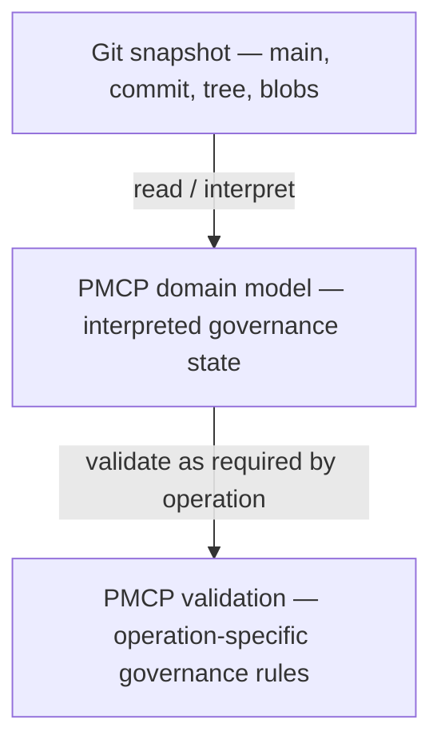

# PMCP Current-State & Design Assessment

**Last updated:** 2026-11-26  
**Repository:** `gunesis-game/pmcp`  
**Working branch:** `main` only  
**Assessment mode:** Ongoing, evidence-based assessment; static inspection unless execution is explicitly recorded.

## Review scope — assess the delta against the project baseline

**Mandatory reading:** Anyone using this review MUST first read `requirements.md` and `architecture.md` in full. Those documents define the product and its intended architecture; this review deliberately does not repeat their content. The current code must also be examined as the implementation under review.

This document records the evidence-based assessment and the **proposed delta** against those inputs: what should change in requirements, architecture, or implementation; why; what has been agreed; and what remains unresolved. It distinguishes current facts, proposed changes, approved decisions, and implementation work. A review proposal does not become a product requirement or architecture decision unless explicitly approved and recorded in the relevant baseline document.

## North Star — Review tracking and continuity

**The review document is the durable source of truth for this review. Chat history is not the tracking mechanism.**

- Every agreed decision, rejected proposal, unresolved question, review status, and resume point must be recorded in `review.md` on `main` as the review progresses.
- After the user agrees to a decision, update and commit `review.md` **before moving to the next topic**.
- Keep the checkpoint current enough that a lost session can be resumed without reconstructing context from chat.
- If the tracker cannot be updated or the commit cannot be verified, stop review progression and explicitly report the failure. Do not continue accumulating unrecorded decisions.
- Do not make implementation changes without explicit user approval.

## Purpose

This document is the persistent cross-session record of the assessment and proposed changes to PMCP. It evaluates the current `requirements.md`, `architecture.md`, and code, then records the proposed and agreed delta from that baseline.

The reader is required to consult `requirements.md` and `architecture.md` for the product definition and intended design. This review records evidence, critical assessment, proposed changes, decisions, unresolved questions, and the resulting change scope.

**The existing requirements, architecture, and implementation are all reviewable; none is presumed correct merely because it exists.** The purpose is to establish what should be retained, changed, or removed, and to make the rationale and agreed delta recoverable across sessions.

The assessment should establish and continually update:

- What the current requirements state, and whether they are sound, complete, coherent, and appropriate.
- What the current architecture proposes, and whether its assumptions, structure, boundaries, and trade-offs are sound.
- What the current code actually does, independent of whether it matches the requirements or architecture.
- Where the three agree, disagree, are incomplete, or make unsupported assumptions.
- What appears valuable to retain, what should be changed, what should be removed, and what remains unknown.
- The evidence and reasoning behind assessments so future sessions can continue without reconstructing lost history.

## Working principles

- Treat **requirements, architecture, and code as three reviewable inputs**, not as a hierarchy in which one automatically validates the others.
- Evaluate correctness and suitability, not just conformance.
- Do not automatically classify divergence from current requirements or architecture as a code defect.
- Do not assume matching implementation proves requirements or architecture are good.
- Distinguish observed facts, assessment/inference, open questions, and decisions.
- Preserve behavior and dependencies as facts even when recommending discarding or redesigning them.
- No implementation changes without explicit approval.
- Work directly on `main`; no branches or pull requests.
- Static review is not runtime proof. Only record tests or experiments as executed when they actually ran.
- Update this document in place after every assessment session. Keep the matrix/register as the current synthesis; keep session history concise and focused on what changed, decisions made, and where to resume. Do not duplicate matrix content in session notes.

## Handoff / current next step

A-019 establishes fixed-`main`, exact-HEAD, single-attempt optimistic publication. A-020 retires `project/policy.json` as a required concept. A-021 establishes CI-owned configuration as the source of verification workflow selection. A-022 makes GitHub Actions the initial provider and testing/verification mandatory governance. A-023 establishes progressively inclusive verification tiers.

Continue by defining the deterministic GitHub Actions discovery and tier-to-workflow mapping contract. Determine how workflow files are discovered and identified, how each workflow declares or is assigned to a tier, and how PMCP rejects missing, ambiguous, invalid, or non-executable required workflows. Keep the distinction between strategy establishment during governance/design and execution as a mandatory implementation-cycle gate.

Then reconcile A-014's evidence snapshot/fingerprint contract and the existing strategy gate with A-020–A-023. Continue individual disposition of former policy fields before rewriting requirements or architecture. No implementation changes without explicit approval.

## Current assessment matrix

| Area | Assessment coverage | Current understanding / assessment |
|---|---|---|
| Requirements and documentation | README, requirements status, documentation authority and decision authority | Initial documentation/status issue was corrected. Requirements remain Draft. Their correctness, completeness, coherence, and fitness for purpose are not yet comprehensively assessed. |
| Architecture and design assumptions | Architecture status, conceptual structure, intended boundaries and feature exposure, architecture-to-tree comparison | Architecture remains Under review. Its fundamental assumptions and design quality are open questions; it is not a baseline to preserve automatically. |
| Coordinator/request lifecycle & replay | Request validation, allowlisted dispatch, read-only/lock behavior, retries, replay, result envelope, next-request derivation | Previously inspected. No confirmed defect was established; R-004 is a robustness question. Functional suitability and design assumptions remain open to reconsideration. |
| CI/evidence selection, polling & gates | Workflow selection/validation, polling, evidence capture, tier/gate semantics, cancellation/failure, policy timing | Previously inspected. R-001 is a policy-snapshot semantics question; R-002 tier overwrite aligns with the per-SHA model; R-003 is observed completion behavior. These are design observations, not endorsements. |
| State/snapshot encoding & integrity | Typed state, clone/re-encode, canonical encoding, digest scope, integrity acceptance | Previously inspected. Digest covers sorted `.pmcp/*.json` state files; project docs/policy excluded by design. Whether this integrity boundary is the right one remains open. |
| Decision ledger & approvals | Propose/record/list, approval modes, decision fields, policy approval refs, cross-record refs | Previously inspected. R-005 is a persisted-state consistency question; cross-record handoff links are not explicitly required by the current Draft contract. Both contract and model may change. |
| Plan updates & reconciliation | Task/criterion mutations, matching, evidence, no-op, reviewed sources, item/reference normalization, persisted metadata | Previously inspected. R-006–R-009 and R-013 are observations/questions about invariants and consistency. Criterion reset/removal is not specified. Whether these concepts and workflows are desirable remains open. |
| Cycle lifecycle, order, preemption & completion | Start/pause/block/unblock/cancel/reorder, micro-cycle promotion, default order, phase gates, timestamps, micro metadata | Previously inspected. R-010 and R-011 are validator questions. The lifecycle model and phase/gating concepts themselves remain open to design reassessment. |
| Checkpoint, handoff, journal & audit | Handoff/checkpoint fields, event log, journal, audit window/watermark, audit advancement | Previously inspected. R-012 is a persisted-state semantic question. Existing audit checks and lifecycle coupling have not been established as optimal design. |
| Repository-store/publication boundary | Store interface/fake, expected-head checks, concurrency retry, commit/read-back/ancestry, atomic publication and failure paths | MemoryStore paths were inspected. Production adapter behavior is unverified. Current abstraction, publication strategy, and guarantees remain open for design review. |
| MCP product/bootstrap & delivery scope | Architecture-to-tree comparison, tool/resource/prompt exposure, configuration, transport, GitHub MCP passthrough/adapters | Source tree reviewed appears to lack runnable server/bootstrap and production GitHub integration components described by architecture. This is a possible delivery gap, but scope and architectural assumptions are themselves unsettled. |
| Tests, evidence & runtime behavior | Test inventory and gaps across validators, plan/reconcile, evidence, replay, store, bootstrap | Source inspection only; no tests executed during this review. Test inventory did not show dedicated validator and plan/reconciliation test files. Runtime behavior remains unverified. |
| Cross-cutting quality & suitability | Not yet systematically assessed across all requirements, architecture, and code | Major open assessment area: complexity, unnecessary concepts, cohesion, usability, failure modes, maintainability, and whether PMCP is solving the right problem. |

## Assessment observations / questions register

These are retained from prior review work as observations to investigate—not a defect backlog and not a commitment to preserve the current requirements or design. They can be reclassified, rewritten, closed, or discarded as the assessment develops.

| ID | Area | Observation / question | Current disposition |
|---|---|---|---|
| R-008 | Reconciliation validation | Recorded metadata appears to allow partial states; should reconciliation metadata have atomic pristine-or-complete semantics? | Needs invariant/design decision |
| R-005 | Decision validation | What consistency is required among approval, recorded-at, specification, and verified-revision metadata for recorded decisions? | Current validator omission observed; model/invariant open |
| R-007 | Reconciliation items | Should persisted item and evidence text be trim-aware nonblank, consistent with action-path validation? | Consistency question |
| R-006 | Reviewed sources | Is a nonempty reviewed-source list required, or can empty review be meaningful? | Workflow/requirement question |
| R-010 | Cycle validation | What timestamps are required for each lifecycle state, including never-started/cancelled cases? | Lifecycle semantics open |
| R-012 | Checkpoint/handoff | What integrity relationships should exist among handoff fields, journal entries, and timestamps/events? | State model question |
| R-011 | Micro-cycle validation | Should eligibility reason and acceptance criteria be trim-aware nonblank, and should micro-cycle concepts exist in the model? | Requirements/design question |
| R-013 | Plan criterion validation | What semantics should govern criterion done-state and evidence, including evidence on unmet criteria? | Requirement semantics open |
| R-009 | Reconciliation references | Scalar whitespace references appear handled differently from whitespace list elements. Should normalization be consistent? | Consistency question |
| R-001 | Evidence governance | Should evidence selection use a policy snapshot during CI wait or revalidate if policy changes? | Design question |
| R-004 | Request idempotency | What should happen when a request ID is reused with a different payload? | Robustness/contract question |
| R-002 | Evidence storage | Same cycle/SHA evidence is replaced when tier changes. Is one-record-per-SHA the right data model? | Design trade-off, not endorsed |
| R-003 | Completion gate | Completion requires full-tier passing evidence. Is that gate appropriate for the intended workflow? | Existing behavior; design question |

## Prior investigation map (not a defect/test priority list)

| Investigation | Previously noted coverage / questions |
|---|---|
| Requirements and architecture validation | Critically assess completeness, contradictions, assumptions, fitness for purpose, and whether the system is solving the right problem—not only code conformance. |
| Persisted state model | Reconciliation states, decision metadata, cycle timestamps, handoff/journal relationships, micro-cycle text fields, criterion evidence semantics, valid minimal states. |
| Mutation/workflow behavior | Plan/reconcile operations, reviewed-source semantics, reference normalization, ambiguous matching, no-op behavior, task/criterion updates, and whether these workflows are needed at all. |
| Evidence and gates | Policy changes during CI wait; same SHA across tiers; pass/fail/pending gate combinations; completion-gate suitability. |
| Request replay | Same ID/same payload and same ID/different payload semantics; replay side effects. |
| Publication/storage | Head movement, retry, ref update failure, read-back failure, uncertain retry, multi-file atomicity, delete vs empty content, ancestry/no-force guarantees, and suitability of the store abstraction. |
| Product delivery | Server/tool/resource/prompt shape, configuration, transport, GitHub MCP passthrough, adapters, and what product scope is actually intended. |
| Runtime evidence | Run tests or targeted experiments only when approved/available; record commands, outcomes, and limitations. |

## Previously recorded implementation observations

These are factual observations from earlier static inspection, subject to re-verification as the repository changes. They are not endorsements of the design.

- Evidence preparation occurs before the branch lock to avoid holding the lock during CI polling.
- Evidence is collected against a commit SHA and stores tier, required workflows, checks, SHA and gate.
- `required_workflows` overrides policy workflow selection; default tier is full; default wait is policy-configured or 15 minutes.
- Evidence polling evaluates latest run per workflow and attaches failure details.
- Snapshot parsing/encoding is typed; clone encodes and reparses; state digest covers sorted `.pmcp/*.json` files only.
- Cycle completion requires a recorded full-tier passing evidence result.
- MemoryStore checks expected-head equality under its mutex and copies written bytes; it is test infrastructure, not production-adapter verification.
- Decision approval modes include attested and issue-comment validation; issue-comment checks approver membership, excludes the acting account, requires post-proposal timing and decision-specific approval text.
- Registry-to-record references and evidence SHA/tier are validated; strategy gates require approved Recorded decisions.
- Audit advancement records watermark, audit row, handoff boundary and journal entry together; validator checks watermark non-negative and anchored to completed execution order.

## Delivery/scope question

Earlier source-tree review suggested governance rules, coordinator abstractions and test fakes exist, while runnable MCP server/bootstrap, GitHub MCP passthrough, MCP transport/adapters, and production GitHub store/facts adapters described by architecture were not found. This observation needs re-verification against the current tree and against a deliberately reconsidered product scope. It must not be treated as proof that those components are necessarily required.

## Direct-to-main change tracking

- All repository work happens directly on `main`. No branches or pull requests.
- No implementation changes without explicit approval.
- Record approved changes here by commit and brief purpose; do not use PR tracking.

## Session continuity log

This log exists specifically to recover continuity when agentic sessions end. Keep entries concise, recording the session's net progress, decisions, newly assessed scope, unresolved questions, and exact next step. Do not restate the matrix/register/backlog; update those sections directly and use session entries as pointers to the changed sections.

### Session 31 — Consolidated review baseline (reframed)

- Previous sessions reviewed broad implementation areas and accumulated R-001–R-013 observations; their chronological detail was removed in the earlier roll-up.
- This review was reframed from defect-finding against presumed-correct requirements/architecture to a neutral assessment of requirements, architecture, and implementation—all of which may be wrong or redesigned.
- Exhaustive traceability across every current code file/symbol and critical assessment of requirements and architecture has **not** been established.
- No tests executed; no source changes made as part of the assessment.
- **Resume at:** neutral, evidence-based traceability and critical assessment. Identify areas requiring deeper inspection; do not assume the goal is to evolve/preserve current architecture.

## Overall assessment status

**Ongoing current-state and design assessment.** No confirmed defect established to date. No tests executed. No implementation fixes made. Requirements, architecture, and code are all open to reconsideration. The current matrix is a partial assessment map—not an exhaustive inventory or a statement that the current system is correct.

## Architectural decisions established during the current review

These decisions were agreed conversationally and must be treated as the current review baseline, subject to further explicit revision:

| ID | Decision | Implication |
|---|---|---|
| A-001 | Git is authoritative for repository state | Git commit/tree/blob/history are the source of truth; PMCP must not duplicate Git snapshot/persistence capabilities unnecessarily. |
| A-002 | Separate three concepts: Git snapshot, PMCP domain interpretation, and PMCP validation | Git snapshot is the input; PMCP interprets governance files into its domain model; validation checks governance integrity/rules. |
| A-003 | Always operate on `main` | Branches are not an application-level PMCP concept. No branch selection or branch-aware architecture. |
| A-004 | No PMCP concurrency subsystem | Do not implement PMCP locks, concurrency management, retry orchestration, or branch-movement recovery. Git owns commit identity/history. |
| A-005 | Validation is operation-specific | Validation requirements depend on the operation's purpose, inputs, dependencies, and effects. Do not impose a blanket full-state validation pipeline. |
| A-006 | Domain model should not duplicate repository mechanics | PMCP domain state should contain interpreted governance concepts, not raw repository file management, Git snapshot mechanics, changed-path detection, publishing, or commit identity. Generic serialization is not inherently a domain responsibility. |

### Agreed conceptual layering

### Further questions (not yet decided)

- Whether malformed/partial state should block a specific operation remains operation-dependent. Parsing failures are distinct from semantic governance validation (A-007).
- Whether a lightweight application/request service is needed after removing branch/lock/retry/snapshot machinery, or whether the existing coordinator should be substantially reduced/replaced.

## Session 32 — Architecture simplification decisions and tracking correction

- User emphasized that "tracking" means **actually updating `review.md` in the repository**, not merely maintaining a chat recap. This failure was acknowledged.
- Updated this file on `main` with the agreed decisions A-001 through A-006, the agreed conceptual layering, unresolved questions, and this session log. This commit is the durable checkpoint; future approved decisions must be recorded in this file before review continues. If the repository update cannot be completed, stop and explicitly report the failure instead of proceeding with more decisions.
- Review focus moved toward governance/domain responsibilities. Initial source inspection surfaced `internal/state/snapshot.go` as combining parsed domain records with raw files, parse errors, serialization/clone, changed-file detection, and digest mechanics. The user agreed that the domain model should not own raw repository-file management or Git snapshot mechanics.
- No code changes were authorized. This session only updates the review tracker.
- **Resume at:** critically inspect governance/domain operations in current source, one issue at a time, and persist each approved decision to `review.md` on `main` before moving forward. Decision A-007 now settles the separation of parsing, domain interpretation, and operation-specific semantic validation.

## Review update — Product North Star added to baseline documents

- At the user's direction, added the shared **Product North Star — Reliable work across limited agent sessions** to the opening of both `architecture.md` and `requirements.md`.
- The framing states that PMCP must support agents with limited reasoning capability, small context windows, short/interrupted sessions, and lost conversation history.
- It establishes the governed GitHub repository as the single durable project memory, containing both the project implementation and its PMCP governance/project knowledge. It explicitly rules out a separate PMCP-managed project database or independently maintained governance store.
- It explains PMCP's role as interpreting and validating repository-resident knowledge and exposing explicit MCP operations/guidance so agents can recover context and continue after session loss or agent replacement.
- This product framing belongs in the requirements and architecture baseline documents. `review.md` remains the delta assessment record and logs this change rather than redefining the product purpose.
- Verified both documents on `main` after writing: `architecture.md` content SHA `e42c51d9d23b5b98db92492ab40c1779176f90d8`; `requirements.md` content SHA `b9a017bbe6610246f8501e0625249fc91cb51bd4`.

### A-007 | Parsing, domain interpretation, and semantic validation

**Status: Approved by the user on 2026-11-26.**

- Parsing converts repository file contents into typed values and returns explicit parsing errors; malformed or missing input is a parsing concern.
- Domain interpretation represents PMCP governance concepts and their relationships. It does not own raw Git/repository file management.
- Semantic validation evaluates governance rules over interpreted domain values. It is distinct from parsing.
- Each governance operation determines which inputs must parse and which semantic rules must hold for that operation. A global full-state validation pipeline is not to be introduced as a replacement.
- Remove `ParseErrors` and `IsUsable()` as domain-model responsibilities; do not simply relocate the same global usability gate.
- Raw repository files, serialization, cloning, digests, and changed-path detection remain outside the PMCP domain model.

Rationale: syntactically malformed data and semantically invalid governance state are different failure classes. Their relevance depends on the operation being performed. Keeping repository representation and mechanics out of the domain model preserves the agreed boundary in A-001/A-002/A-006.

### Session 33 — Parsing and validation separation

- User approved A-007. Recorded the decision above and updated the unresolved parsing question and resume point.
- No implementation changes authorized or made.
- **Resume at:** inspect the current governance operations and their actual input dependencies/validation behavior. Use concrete call sites to assess whether the operation-specific boundary is respected; propose one next design decision at a time and record approval here before continuing.

### A-008 | Canonical governance state file and Git-backed history

**Status: Approved by the user on 2026-11-26.**

- Replace the multiple `.pmcp/*.json` governance state files with one canonical `.pmcp/state.json` file.
- The canonical file represents the complete current PMCP governance state at a given Git commit.
- Git commits and history are the sole source of version history. PMCP must not introduce a separate state-versioning or history store.
- Governance operations may retrieve the state file from `HEAD` and relevant ancestor commits, then compare snapshots to understand state transitions.
- The amount of history inspected is determined by the needs of the operation; do not impose a universal fixed history depth.
- Distinguish structural state comparison from governance interpretation: a diff identifies what changed, while PMCP governance rules determine the meaning and validity of that transition.
- A repository commit does not necessarily represent a governance transition; commits that do not change `.pmcp/state.json` need not be interpreted as state transitions.

Rationale: Git already provides immutable commit snapshots and historical retrieval. A single canonical state file simplifies the persistence and parsing boundary while preserving Git as the only durable source of state history. It does not eliminate semantic validation of relationships and governance rules within or across snapshots.

No implementation changes are authorized by this decision.

### Session 34 — Canonical state representation decision

- User approved A-008: one canonical `.pmcp/state.json`, with Git commits as the sole state history and operation-dependent historical comparison.
- Recorded A-008 in this review tracker on `main`; no implementation files changed.
- **Resume at:** continue inspecting actual governance operation call sites and their input dependencies/validation behavior. Then assess operation-specific validation as a separate decision. The previously discussed validation proposal is not yet approved.
### A-009 | Operation-specific dependencies and validation

**Status: Approved by the user on 2026-11-26.**

- Each governance operation must have an explicit set of state inputs it reads.
- Each operation must identify the invariants that must hold for those inputs.
- Each mutation must identify the state it changes and the invariants that must hold after the mutation.
- Historical comparisons are required only when the operation's governance rules depend on the transition; they are not an automatic prerequisite for every operation.
- Semantically invalid unrelated governance data must not block an operation whose required inputs and invariants are valid.
- Comprehensive repository/governance validation remains available as a diagnostic capability, but is not a prerequisite gate for every operation.
- Do not introduce a global `IsUsable()` gate or an equivalent all-state usability gate.
- Use an operation-dependency matrix as the design specification before changing the coordinator.

Clarification: the canonical `.pmcp/state.json` must still parse as a complete document before it can be interpreted. Operation-specific validation narrows semantic preconditions and invariants; it does not imply partial parsing of malformed JSON.

Rationale: operations have different state dependencies and governance obligations. A global validation gate allows unrelated semantic defects to prevent valid work. Explicit dependencies make preconditions, mutation effects, and any required historical comparisons reviewable and testable.

No implementation changes are authorized by this decision.

### Session 35 — Operation-specific validation decision

- User approved A-009: explicit per-operation state dependencies, preconditions, mutation effects, and post-mutation invariants; no global usability gate.
- Record that full-state validation remains diagnostic rather than a universal operation gate.
- No implementation files changed.
- **Resume at:** construct and verify the operation-dependency matrix from all registered operations, including exact state fields, repository inputs, historical reads, and mutation effects. Reconcile the matrix with requirements and architecture docs before proposing implementation changes.
### A-010 | Normative operation contract

**Status: Approved by the user on 2026-11-26.**

- Every registered governance action must have an explicit operation contract.
- Each contract specifies required parsed state inputs; state records/fields read; semantic preconditions and invariants; conditional dependencies and their activation conditions; external inputs (repository documents, Git history, GitHub data); exact state records/fields it may mutate; and post-mutation invariants.
- Dependencies must be minimal and explicit. Unrelated governance records must not be required to be semantically valid.
- Conditional behavior must be represented explicitly; do not make every possible dependency mandatory for every invocation.
- External inputs remain distinct from canonical governance state. Git/GitHub and repository mechanics are not responsibilities of the governance domain model.
- All mutation effects must be declared, including journals, checkpoint metadata, timestamps, revisions, and other secondary effects.
- Historical comparisons are specified only where a governance rule requires historical context. No automatic history scan or universal history depth.
- The coordinator must enforce each operation's contract: ensure required inputs are available and parsed, invoke operation-specific preconditions, and verify declared postconditions. It must not reinstate a global full-state validation or usability gate.
- The operation-dependency matrix is to be formalized and verified as the design specification before coordinator redesign or implementation.

Rationale: a normative contract makes operation dependencies, governance obligations, external facts, mutation effects, and historical requirements explicit and testable. It replaces implicit global assumptions with reviewable per-operation behavior.

No implementation changes are authorized by this decision.

### Session 36 — Normative operation contract decision

- User approved A-010 as written.
- The first-pass operation-dependency matrix is accepted as the basis for detailed contracts, subject to refinement against actual registered actions and call paths.
- No implementation files changed.
- **Resume at:** formalize and verify the detailed operation contracts for every registered action, including conditional branches, exact fields, external inputs, mutation side effects, preconditions, postconditions, and historical requirements. Then reconcile `requirements.md` and `architecture.md` with A-007 through A-010 before proposing coordinator redesign.
### A-011 | Detailed cycle operation contracts

**Status: Approved by the user on 2026-11-26.**

- The ten cycle action contracts reviewed in Session 37 are approved as the detailed basis for coordinator redesign: `cycle.create`, `cycle.start`/`cycle.resume`, `cycle.pause`, `cycle.block`, `cycle.unblock`, `cycle.cancel`, `cycle.transition`, `cycle.complete`, `cycle.promote`, and `cycle.reorder`.
- Contracts capture required state, conditional dependencies, mutation effects (including journal/checkpoint metadata), no-op behavior where identified, and historical comparison requirements.
- Preserve conditional lifecycle behavior: micro cycles lack ordinary plan/checkpoint records until promoted; preemption may pause and promote an existing micro cycle; completion may resume another paused cycle.
- The identified `pauseCycle` checkpoint assumption must be corrected during implementation: required checkpoint dependencies must be explicit, and missing required checkpoints must not result in silent partial updates. The current behavior is not approved as a valid invariant.
- The completion operation's audit-status calculation is part of its current output behavior; it is not thereby authorized to mutate independent audit state.
- These contracts specify intended behavior and dependencies, not authorization to preserve every current implementation detail.

No implementation changes are authorized by this decision.

### Session 37 — Cycle operation contract approval

- User approved all ten detailed cycle operation contracts.
- No implementation files changed.
- **Resume at:** formalize the remaining non-cycle operation contracts (plans, checkpoints, decisions, evidence, audit, and status), then verify all contracts against registered actions and implementation call paths. Reconcile requirements and architecture with A-007 through A-011 before proposing implementation.
### A-012 | Reconciliation as a mandatory governed workflow gate

**Status: Approved by the user on 2026-11-26.**

- Reconciliation is a mandatory, phase-controlled workflow step, not an optional operation performed at an agent's discretion.
- A standard cycle enters the designated `reconcile` phase only after the required implementation and verification gates pass.
- Reconciliation reviews the authoritative project/governance state against what was planned and what actually occurred; it records the assessment and discrepancies.
- A standard cycle cannot complete without a valid reconciliation for the relevant project state.
- Reconciliation records the exact Git revision reviewed. The reviewed revision is never silently advanced.
- Relevant changes after the reviewed revision invalidate the reconciliation for completion purposes and require a fresh reconciliation. Invalidation is based on substantive changes, not elapsed time or commit count.
- The reconciliation's own state/journal commit does not invalidate itself. Explicitly defined non-substantive PMCP bookkeeping changes (such as unrelated checkpoint/administrative metadata) do not invalidate it. Changes to source/tests, requirements, architecture, decisions, plan tasks/criteria, or evidence affecting verification do invalidate it.
- Reconciliation records an assessment; it does not itself make a cycle complete or assert that all possible future issues are eliminated. Contradictions must be corrected at their authoritative source and must not be classified away.
- The precise set of relevant paths/state transitions and the mechanical invalidation algorithm still require formalization against the canonical state/history design before implementation.

Rationale: a governed process must determine when reconciliation happens and enforce it as a lifecycle gate. A revision-bound record makes the review auditable and prevents stale reconciliation from authorizing completion after relevant changes.

### Session 38 — Non-cycle operation contract approvals and tracking correction

- User approved the reconciliation workflow and invalidation rule in A-012.
- User approved the detailed contracts for `checkpoint.save`, `plan.update`, `decision.propose`, `decision.record`, and `decision.list`. These are accepted operation contracts under A-010; they are not implementation authorization.
- The contracts require explicit minimal dependencies, conditional cycle/checkpoint requirements, atomic publication of all declared side effects, clean rejection instead of nil-pointer panics, and no unrelated global semantic validation.
- `decision.record` requires both verified approval and published-specification evidence; decision/policy/checkpoint/journal effects publish atomically.
- The user correctly identified that the review's North Star had been violated: approved decisions were accumulated in chat without updating `review.md` before proceeding. This update restores the durable tracker. Future progression must stop after each approval until `review.md` is updated and the commit is verified.
- No implementation files changed. This commit updates the review tracker only.
- **Resume at:** continue detailed contracts for remaining registered operations, beginning with the next decision operation after `decision.list`; verify each against actual registered actions and call paths. After each user approval, update and verify this file on `main` before moving to the next contract. Reconcile the requirements and architecture baselines with the approved decisions before coordinator redesign.

### A-013 | Bind collected evidence to its verification policy

**Status: Approved by the user on 2026-11-26.**

- Collected evidence is bound to the exact implementation Git revision (commit SHA) it verifies and to the verification policy snapshot that determined the required checks.
- The required workflow set is derived from that policy snapshot and retained as part of the evidence record.
- The evidence record must identify the policy revision or an equivalent stable fingerprint of the verification-relevant policy. A mutable or implicit reference to "current policy" is insufficient.
- Evidence collected under an earlier verification policy remains historical evidence, but must not satisfy a gate evaluated under a different verification policy when the difference affects required verification.
- Changes to verification-relevant policy invalidate the evidence for satisfying the current verification gate; unrelated policy changes do not.
- Historical evidence is retained rather than deleted or rewritten.

Rationale: evidence is meaningful only relative to both the implementation revision and the rules used to verify it. Without policy binding, evidence collected under weaker or otherwise different requirements could be reused to satisfy a newer gate.

No implementation changes are authorized by this decision.

### Session 39 — Evidence policy binding decision

- User approved A-013: evidence must be bound to the implementation revision and the verification-relevant policy snapshot that selected required checks.
- The initial tracker write accidentally replaced the document with only the appended section. This was immediately identified and recovered from the parent commit; the complete prior review history is restored below, with A-013 appended.
- The corrective commit restores the full tracker and records A-013. No implementation files changed and no tests were executed.
- **Resume at:** continue the remaining non-cycle operation contracts after `evidence.collect`, beginning with `audit.check`; verify each against registered actions and implementation call paths. Then reconcile `requirements.md` and `architecture.md` with A-007 through A-014 before proposing coordinator redesign.

### A-014 | Complete contract for `evidence.collect`

**Status: Approved by the user on 2026-11-26.**

- Purpose: collect verification results for an exact implementation revision under an identified verification-policy snapshot.
- Accepted arguments: `sha`, `tier`, `components`, `required_workflows`, `wait_minutes`, and `cycle`; unknown arguments are rejected.
- An explicit SHA must resolve to a full commit SHA. When omitted, select the newest qualifying implementation commit using the defined selection rule.
- Tier is `fast`, `integration`, or `full`, defaulting to `full`. Required workflows are derived from the policy snapshot and tier; an explicit `required_workflows` argument overrides policy selection.
- Components are valid only with the `fast` tier and include tests for the named components and their transitive dependants.
- Wait duration is explicit when supplied, otherwise policy-configured, otherwise 15 minutes. The configured maximum is enforced and capped at 60 minutes.
- Evidence identifies both the implementation SHA and the policy source revision plus a stable fingerprint of the verification-relevant policy used to derive required checks.
- CI runs are evaluated for the exact implementation SHA, selecting the latest run per workflow by creation time and then attempt. Gate outcomes are `pass`, `fail`, `pending`, or `no-required-checks`.
- Failed workflows include bounded failure detail: failed jobs, failed steps, and annotations.
- An explicit cycle must resolve to an open standard cycle. Without one, use the in-progress standard cycle if present. If no standard cycle is available, return evidence without storing it.
- When a cycle is targeted, evidence and its journal entry are published atomically. Evidence collection does not itself transition cycle lifecycle state.
- Historical evidence is retained. Different verification contexts for the same implementation SHA must not overwrite one another; evidence identity/storage must distinguish at least SHA, tier, and verification-policy fingerprint.
- Policy changes during CI polling must not cause evidence to be represented as having been collected under the newer policy. A current gate accepts only evidence whose verification-relevant policy matches the policy required by that gate.
- Validate state prerequisites and the target cycle before spending time collecting CI evidence.
- Polling is governed by required workflows; optional in-progress workflows must not delay a required-check gate that has already passed.
- Coordinator-level replay and validation behavior remains a coordinator redesign concern; it must not be hidden in the evidence operation contract or reintroduce blanket semantic validation.

Rationale: evidence is meaningful only when its implementation revision and verification policy are explicit. The operation must preserve historical results, enforce the correct target and gate semantics, and avoid misleading evidence when policy changes during collection.

No implementation changes are authorized by this decision.

### Session 40 — Evidence collection contract approval

- User approved A-014, completing the detailed `evidence.collect` contract after A-013 established policy-bound evidence.
- Static inspection confirmed current gaps: the evidence model has no policy revision/fingerprint; evidence is keyed by SHA alone; cycle resolution occurs after CI collection; optional in-progress workflows can prolong polling; and coordinator replay occurs after evidence preparation.
- No implementation files changed and no tests were executed. This update records the approved contract only.
- **Resume at:** continue with the next remaining non-cycle operation contract, `audit.check`, and verify it against registered actions and implementation call paths. After each approval, update and verify this file on `main` before proceeding. Reconcile `requirements.md` and `architecture.md` with A-007 through A-014 before coordinator redesign.

### A-015 | Complete contract for `audit.check`

**Status: Approved by the user on 2026-11-26.**

- `audit.check` is a read-only query with no arguments; supplied arguments are rejected.
- It reads the cycle registry and audit watermark and selects every completed cycle whose execution order is strictly greater than the watermark.
- The audit window is ordered by execution order, ascending.
- It returns the watermark, number of cycles in the window, whether an audit is due, sequence numbers, and one review entry per cycle.
- Standard-cycle review entries identify the plan, checkpoint, and evidence record locations. Micro-cycle entries include their outcome and verification evidence.
- The audit is due when at least three completed cycles are beyond the watermark. The threshold is retained provisionally from REQ-080 and remains subject to requirements reconciliation.
- The operation does not require an in-progress cycle, does not mutate governance state, does not append a journal entry, does not publish a Git commit, and does not advance the watermark.
- Its semantic validation is operation-specific: only the cycle registry and audit data necessary to calculate and represent the audit window must be valid. Unrelated semantic defects must not block the read.
- Invalid or insufficient prerequisite data must produce a clear rejection/error, never a panic or misleading audit result.
- The response is an index of material to review; it does not assert that documentation has been reviewed or reconciled. Review occurs separately, followed by `audit.advance`.

Rationale: audit discovery and audit completion are separate actions. A read-only query must reliably identify the exact outstanding window without modifying it or being blocked by unrelated governance defects.

No implementation changes are authorized by this decision.

### Session 41 — Audit check contract approval and canonical-state alignment reminder

- User approved A-015, the complete `audit.check` contract.
- User reiterated that all work reviewed and approved so far must align with the Git-commit history and canonical `.pmcp/state.json` architecture established by A-008.
- This is a mandatory cross-cutting reconciliation constraint, not a new persistence exception: the approved operation contracts must be reconciled so their state inputs, records, mutation effects, audit/evidence identities, journal/checkpoint effects, and historical comparisons are represented through one canonical state document at each Git commit. Git history is the only durable state-version history; no parallel PMCP history/version store and no retained multi-file `.pmcp/*.json` state model.
- The architecture reconciliation must explicitly revisit every approved contract (A-007 onward), including A-011 cycle side effects, A-012 revision-bound reconciliation, A-013/A-014 policy-bound evidence, and A-015 audit-window calculation. Where a contract describes logical records or atomic effects, map them into the single state document and a single Git commit rather than interpreting them as separate persisted files.
- The current `requirements.md` and `architecture.md` still describe the multi-file state layout and therefore require deliberate reconciliation; do not treat the current documentation as already aligned.
- No implementation files changed and no tests were executed. This commit records A-015 and the architecture-alignment constraint only.
- **Resume at:** review the final remaining non-cycle operation contract, `status.report`, against registered actions and call paths. Then reconcile requirements, architecture, and all approved operation contracts with A-008's canonical `.pmcp/state.json` and Git-history model before proposing coordinator redesign. Update and verify `review.md` after every subsequent approval. No implementation without explicit approval.

### Session 42 — Shared governance history infrastructure and commit metadata direction

- User corrected the proposed `status.report` contract: `status.report` is only the agent-facing tool that requests and presents a report. The underlying Git-history and state-reconstruction infrastructure must be reusable by other components and operations; it must not be implemented as logic owned by `status.report`.
- Agreed architectural direction: shared infrastructure must be able to filter Git commits. This requires commits produced by PMCP-governed components to carry useful, canonical, machine-readable commit metadata. Git commit trailers were proposed as a candidate representation (for example operation, record type, cycle and state schema), but the exact convention and its mandatory scope are **not yet approved**.
- Authority rule proposed: commit metadata is a classification/indexing aid, while the committed `.pmcp/state.json` is authoritative for resulting governance state. The infrastructure must cross-check metadata against actual commit contents and state transitions; metadata alone never proves an operation succeeded. Legacy/missing metadata handling remains to be designed.
- Shared infrastructure responsibilities identified: filter commit history; retrieve each relevant commit's `.pmcp/state.json`; compare snapshots; reconstruct transitions; validate transitions under applicable governance rules; preserve commit provenance; and expose reusable query/scope APIs to consumers. It must distinguish governance state transitions from ordinary code-only commits. Consumers must not duplicate this logic.
- `status.report` remains the final non-cycle operation contract under review (A-017 is **not approved or recorded**). Its revised responsibility is to request an appropriate history reconstruction and render an agent-readable consolidated report; it does not own Git traversal or reconstruction.
- The earlier A-016 draft that treated status as a direct current-snapshot diagnostic is superseded by this clarification and must not be treated as approved.
- User explicitly raised the review North Star/continuity failure. This session entry and the revised handoff are being committed now before any further discussion. No implementation changes or tests were performed.
- **Exact resume point:** continue the shared governance-history infrastructure design from the commit-filtering and canonical commit-metadata requirement. Decide the metadata convention and which commits require it; then finish the revised A-018 `status.report` consumer contract. After all operation contracts, reconcile requirements, architecture and every approved contract against the single `.pmcp/state.json` per Git commit and Git-history-only versioning. Update and verify this tracker after every approval. No implementation without explicit approval.

### A-016 | Shared governance-history commit classification and metadata

**Status: Approved by the user on 2026-11-26.**

- Git commits are the historical facts. Commit metadata is a machine-readable classification and indexing aid; it is not a second source of governance authority.
- The canonical `.pmcp/state.json` committed at each revision is authoritative for the resulting governance state. Metadata must be checked against the commit's actual tree contents and the parent-to-child state transition. Metadata alone never proves that an operation succeeded.
- Distinguish at least three classes during history analysis:
  - **PMCP governance commits:** commits produced by an approved PMCP operation that changes governance state. They carry the canonical PMCP metadata required by the convention and include the resulting `.pmcp/state.json`; the claimed operation and state transition must be verifiable.
  - **Implementation commits:** ordinary project/source/test/documentation changes. They need not carry PMCP governance trailers and remain visible to history analysis and evidence/reconciliation rules; they are not automatically governance state transitions.
  - **External or unclassified commits:** commits not established as PMCP governance commits. Classify from their actual contents and state snapshots; detect and evaluate any `.pmcp/state.json` change. Missing or contradictory metadata must not be trusted as proof of a valid PMCP operation.
- The canonical metadata convention for PMCP governance commits must identify the producing tool and action, request identity, state digest, schema version, and result. Existing Git parent/commit identity supplies ancestry and provenance; do not redundantly create a separate PMCP history identity. Whether a separate stable transition identifier is necessary remains open pending contract-level analysis.
- Commit filtering must not rely exclusively on trailers. The shared infrastructure discovers relevant history, retrieves the canonical state snapshot at relevant commits, compares snapshots, reconstructs actual transitions, validates them under the applicable governance rules, preserves provenance, and exposes reusable query/scope APIs.
- History discovery must be able to inspect the relevant ancestry as required; a fixed recent-N commit window must not silently truncate the history needed to establish a state transition or provenance.
- Shared history/state reconstruction is reusable by multiple components and operations. It is not owned by `status.report`; consumers must not duplicate Git traversal, classification, reconstruction, or transition validation.
- The previous direct-current-snapshot `status.report` draft is superseded and was never approved. To avoid reusing its abandoned identifier, the revised `status.report` consumer contract is now tracked as A-018. This is a tracker renumbering only; no contract for A-017 is approved yet.

Rationale: governance needs a reliable way to distinguish state transitions from ordinary repository work while retaining Git as the sole historical authority. Machine-readable metadata makes filtering practical, but verifying the committed state and actual transition prevents metadata from becoming a parallel or self-authenticating record.

No implementation changes are authorized by this decision.

### Session 43 — Commit metadata and shared history classification approved

- User approved A-016, establishing the principles for classifying governance, implementation, and external/unclassified commits and using metadata as a verifiable filtering aid.
- The revised `status.report` consumer contract is tracked as A-017 because the earlier A-016 status draft was superseded and never approved.
- The exact trailer spelling/format, mandatory schema/version compatibility rules, legacy migration behavior, and whether a separate transition identifier is needed remain to be specified against the existing implementation before any implementation proposal.
- No implementation files changed and no tests were executed. This commit updates the review tracker only.
- **Resume at:** inspect the existing commit metadata implementation against A-016, settle the precise canonical metadata convention and legacy handling, then define A-017 `status.report` as a thin consumer of shared history reconstruction. After approval, update and verify this file before proceeding to architecture/requirements reconciliation. No implementation without explicit approval.

### A-017 | Canonical PMCP commit metadata convention and legacy handling

**Status: Approved by the user on 2026-11-26.**

- New state-changing PMCP governance commits use exactly one of each required trailer:
  - `Pmcp-Metadata-Version: 1`
  - `Pmcp-Tool: <tool>`
  - `Pmcp-Action: <action>`
  - `Pmcp-Request: <request-id>`
  - `Pmcp-State-Digest: <digest>`
  - `Pmcp-Result: <compact result envelope>`
- `Pmcp-Metadata-Version` versions the commit-metadata convention. It is distinct from the schema version of the canonical `.pmcp/state.json`.
- `Pmcp-State-Digest` identifies the digest of the canonical committed `.pmcp/state.json`.
- `Pmcp-Result` retains the compact stored operation-result envelope.
- New-format metadata must be parsed and validated strictly. Duplicate, missing, malformed, or contradictory required trailers make the metadata invalid; invalid metadata must not be accepted as proof of a PMCP governance transition.
- Existing unversioned PMCP commits are legacy history. Preserve them without rewriting. Reconstruct their state transitions from Git snapshots and validate what can be established from their actual contents; do not treat old trailers as if they satisfy the new versioned convention.
- Commits without valid PMCP metadata remain unclassified until their actual tree changes and state snapshots have been examined. The absence of metadata does not exclude a commit from relevant history.
- This convention applies to new PMCP governance commits that change canonical governance state. Ordinary implementation commits do not require these trailers.

Rationale: a versioned, strict metadata envelope gives shared history infrastructure a stable classification aid while preserving historical commits and keeping the committed state document authoritative.

No implementation changes are authorized by this decision.

### Session 44 — Canonical metadata convention approved

- User approved A-017: versioned metadata for new PMCP governance commits, strict validation of the six required trailers, digest binding to canonical `.pmcp/state.json`, and non-destructive treatment of legacy unversioned commits.
- The metadata-version trailer is distinct from the state-document schema version.
- The revised `status.report` consumer contract is A-018. The earlier A-016 status draft was superseded and never approved; A-017 is the metadata convention.
- Existing implementation has not been changed. Static inspection identified the current five-trailer format, permissive parser, and lack of explicit metadata versioning. No tests were executed.
- **Resume at:** define A-018 `status.report` as a thin agent-facing consumer of shared history/state reconstruction. Then reconcile requirements, architecture and all approved contracts against the single canonical `.pmcp/state.json` per commit and Git-history-only versioning. Update and verify this tracker after every approval. No implementation without explicit approval.

### A-018 | Revised `status.report` consumer contract

**Status: Approved by the user on 2026-11-26.**

- `status.report` is the agent-facing operation for requesting and presenting a consolidated governance status report. It is a consumer of shared governance-history infrastructure, not the owner of that infrastructure.
- The operation is `status.report`, takes no arguments, rejects unknown arguments, and is strictly read-only. It performs no state mutation, journal append, watermark update, or Git commit.
- Shared infrastructure, requested by the coordinator, supplies the canonical state snapshot at exact current HEAD; relevant governance commits and provenance; reconstructed transitions in chronological order; commit classifications; metadata validation; state-integrity and transition-validation findings; and explicit history completeness/limitations.
- Shared infrastructure owns Git traversal, commit classification, snapshot retrieval, transition reconstruction and validation. Consumers must not duplicate those responsibilities. History discovery must not silently truncate relevant ancestry using a fixed recent-commit limit.
- The report retains current-state information from REQ-020: branch and exact HEAD revision; registry/governance validation; active cycle and checkpoint/handoff details; paused, blocked and pending cycles; status counts; default next cycle; proposed decisions; approved strategies and strategy gaps; and audit watermark/window/due status.
- The report additionally presents the governance-state revision, verified transitions and their commit/operation provenance, unclassified or externally modified state changes, invalid/contradictory metadata, and history reconstruction completeness.
- Current-state validity and historical reconstruction validity are distinct dimensions and must not be collapsed into one boolean. A structurally valid current state does not prove its history is valid; a verifiable history does not imply the current state is semantically valid.
- Partial information must be labelled. If state parsing or history reconstruction is incomplete, the report distinguishes verified facts from unknowns and explains the limitation. Invalid metadata is reported as invalid and cannot establish a successful operation. Unverifiable transitions identify the relevant commit and reason. A partial reconstruction must never be represented as complete.
- `audit.check` remains the dedicated audit-window discovery operation. `status.report` may display whether an audit is due but does not perform an audit or advance its watermark. Evidence collection and lifecycle operations remain responsible for their own actions and may consume shared history services independently.
- This contract defines consumer behavior and information requirements, not the internal implementation/API shape of the shared history service.

Rationale: status is an agent-facing view over authoritative state and verified history. Separating it from reusable history infrastructure prevents duplicated Git/reconstruction logic and keeps current-state validity distinct from historical provenance and transition validity.

No implementation changes are authorized by this decision.

### Session 45 — A-018 status consumer contract approved

- User approved A-018, defining `status.report` as a read-only, no-argument consumer of shared governance-history reconstruction.
- The contract retains the current REQ-020 status fields and adds history-derived transitions, provenance, classification/metadata findings, and explicit completeness/limitations.
- Current-state validity and historical reconstruction validity are separate report dimensions. Partial or invalid history must be disclosed rather than presented as complete.
- Static inspection confirmed the current implementation is still snapshot-centric: `StatusReport.Apply` consumes prepared validation/integrity facts and the current typed snapshot; the coordinator's read-only path reads a bounded recent commit set. Shared history reconstruction does not yet exist. This is an observation, not an implementation change.
- No implementation files changed and no tests were executed. The full tracker was preserved and updated in place.
- **Resume at:** read `requirements.md` and `architecture.md` in full, then reconcile their multi-file state layout, commit/history assumptions, and all approved operation contracts (A-007 onward) against the canonical `.pmcp/state.json` per commit and Git-history-only versioning. Do not redesign or implement until the contradictions and contract impacts have been assessed and presented for approval.

### A-019 | Optimistic single-attempt publication execution model

**Status: Approved by the user on 2026-11-26.**

- PMCP always operates on `main`, consistent with A-003. There is no branch-selection or branch-aware PMCP workflow.
- Every state-changing operation reads the exact current `main` HEAD and computes its complete proposed change from that observed revision.
- The operation makes one optimistic publication attempt whose expected parent is the exact HEAD it read. Publication must use Git's non-force ref-update/expected-parent protection so it cannot overwrite a newer commit.
- If `main` has advanced before publication, the operation fails with a clear revision-conflict result. It does not silently recompute against the newer state.
- The caller must reread the new HEAD and explicitly issue a new request based on the refreshed state.
- PMCP does not implement locks, serialization, automatic retries, automatic replay, or a concurrency-management subsystem. Git's commit/ref-update semantics provide the publication boundary.
- A failed publication creates no governance state transition and must not be reported as a successful operation.

Rationale: the operation's decision and validation are bound to the exact state the caller acted upon. A single expected-parent publication prevents lost updates without introducing hidden retries or PMCP-owned concurrency orchestration. Requiring a fresh request after conflict keeps the agent aware that its governing context changed.

No implementation changes are authorized by this decision.

### Session 46 — Foundational execution model approved

- User approved A-019, establishing fixed-`main`, exact-HEAD mutation planning, and one expected-parent publication attempt.
- A moved `main` produces an explicit revision conflict; the caller rereads and submits a new request. No PMCP lock, retry, serialization, or automatic replay subsystem is permitted.
- A failed publication is not a governance transition.
- Updated the handoff to the next foundational reconciliation decision: define the canonical repository/state model, including the boundary between `.pmcp/state.json` and separately owned project policy.
- No implementation files changed and no tests were executed. This tracker update is the only repository change in this session.

### A-020 | Retire the current policy-file concept

**Status: Approved by the user on 2026-11-26.**

- Retire `project/policy.json` as a required architectural concept. PMCP must not assume that this file exists, must not require it as a setup prerequisite, and must not preserve its current schema merely for compatibility with the existing design.
- Do not mechanically move the existing policy document into `.pmcp/state.json`. The existing file combines several different kinds of information and each must be reassessed according to its actual purpose.
- Strategy approvals are governance facts already represented by Recorded decisions. Approval status and strategy gaps should be derived from the decision ledger rather than duplicated in a separate `approvals` object.
- Branch-selection and Git-workflow settings that conflict with the fixed-`main` model (A-003, A-019) must not be retained as configurable PMCP policy.
- Remaining fields—such as evidence-tier workflow mappings, component/test mappings, project commands, performance criteria, and decision-approval configuration—are not automatically retained or migrated. Each must be justified individually and assigned to the correct owner: canonical governance state, project documentation/configuration, CI configuration, or nowhere if unnecessary.
- Any configuration that remains must have an explicit source of authority, lifecycle, and revision/fingerprint semantics where governance or evidence depends on it. This decision does not create a replacement policy file or authorize a new configuration store.
- Requirements, architecture, and implementation must be reconciled to this direction before implementation changes are proposed.

Rationale: the existing policy file mixes duplicated governance state, obsolete workflow controls, and potentially useful project/CI configuration. Treating all of these as one mandatory policy artifact creates unnecessary coupling and duplicated authority. Retiring the concept allows each remaining piece to be justified independently.

No implementation changes are authorized by this decision.

### Session 47 — Policy-file concept retired

- User approved A-020: retire `project/policy.json` as a required architectural concept.
- The existing policy fields are not to be copied wholesale into canonical state or automatically migrated. Approvals should be derived from the decision ledger; fixed-`main` supersedes configurable branch/workflow policy; remaining configuration requires individual justification and an explicit owner.
- The handoff now prioritizes completing the canonical repository/state model and classifying the former policy fields before reconciling dependent contracts and documentation.
- No implementation files or baseline documents changed; this session updates the review tracker only. No tests were executed.

### A-021 | CI-owned verification workflow configuration

**Status: Approved by the user on 2026-11-26.**

- CI-owned repository configuration is the source of truth for selecting verification workflows used by evidence collection. PMCP must not require or introduce a replacement project policy file for this purpose.
- Evidence tiers (such as fast, integration, and full) may remain as PMCP concepts, but the workflow selection associated with a tier must be derived from or explicitly mapped to the repository's CI-owned configuration.
- PMCP must define a deterministic discovery and interpretation contract for the relevant CI configuration. It must not assume that arbitrary workflow files or CI settings automatically form an unambiguous tier mapping.
- Evidence must record the selected workflows and their provenance. The exact relevant CI configuration used for selection must be fingerprinted so evidence remains bound to the verification policy in force when it was collected, preserving A-014's policy snapshot/fingerprint requirement without retaining `project/policy.json`.
- This decision does not settle the CI discovery convention, supported CI providers, tier-to-workflow mapping syntax, or fingerprint algorithm. Those require explicit design and approval.
- No automatic migration of former `testing.tiers` or `testing.components` fields is authorized. Component mapping remains optional and must be justified independently.

Rationale: verification workflow definitions belong to the CI system that executes them. PMCP should consume a deterministic, revision-bound view of that configuration rather than maintaining a duplicate policy registry.

No implementation changes are authorized by this decision.

### Session 48 — CI-owned verification configuration approved

- User approved A-021: CI-owned repository configuration is the source of verification workflow selection; no replacement PMCP policy file is to be introduced.
- A-014 remains in force: evidence must preserve a policy snapshot/fingerprint. The next design must bind that snapshot to the exact CI configuration used for workflow selection and record selected workflow provenance.
- CI discovery, provider support, tier mapping and fingerprinting remain unresolved design questions.
- The review tracker is the only file changed. No implementation or baseline requirements/architecture files were changed; no tests were run.
- **Resume at:** define deterministic CI configuration discovery and tier-to-workflow mapping, then reconcile A-014 and the strategy gate. Continue individual disposition of all former policy fields before rewriting requirements or architecture.

### A-022 | Mandatory testing workflows with GitHub Actions as the initial provider

**Status: Approved by the user on 2026-11-26.**

- PMCP initially supports GitHub Actions as its CI provider for governed testing and verification workflows. Support for other CI providers is deferred to future explicit extensions; it is not part of the initial provider contract.
- Testing and verification workflows are a mandatory part of project governance. They are not an optional capability, optional policy choice, or merely a convenience for evidence collection.
- Governance/design must establish the project's testing and verification strategy and the applicable workflows. The strategy and workflow configuration must be deterministically discoverable from CI-owned repository configuration, consistent with A-021.
- When a cycle reaches implementation, the applicable testing/verification workflows become mandatory validation gates. Implementation is not considered validated merely because code changes have been made or an agent claims they are complete.
- PMCP must provide an agent-facing way to determine which workflows apply to the implementation, run or request their execution through the supported GitHub Actions integration, inspect their results, and use the resulting evidence to validate the implementation.
- Evidence must remain bound to the implementation revision and the exact relevant CI configuration/fingerprint used to select the workflows, preserving A-014 and A-021. It must identify the selected workflows, their provenance, and their outcomes.
- A missing, ambiguous, invalid, or non-executable required workflow configuration must be surfaced as a governance/validation failure or blocker; it must not silently degrade into optional testing or passing evidence.
- This decision establishes mandatory status and initial provider scope. It does not yet define the exact GitHub Actions discovery convention, workflow-to-tier mapping syntax, required workflow inventory, invocation permissions/mechanism, result interpretation, or fingerprint algorithm. Those remain explicit design questions.

Rationale: testing is part of the governed path from design to implementation, and PMCP is intended to guide agents through that path. GitHub Actions provides a concrete initial execution and evidence source; deferring other providers keeps the first contract deterministic without making testing itself optional.

No implementation changes are authorized by this decision.

### Session 49 — Mandatory testing workflow direction approved

- User approved GitHub Actions as the initial and only CI provider in scope, with other providers deferred to explicit future extensions.
- User clarified that testing/verification workflows are mandatory governance, not optional configuration. The project must establish its strategy during governance/design; applicable workflows become mandatory validation gates when cycles reach implementation.
- The handoff now focuses on deterministic GitHub Actions discovery/mapping and the agent-facing workflow execution/result/evidence path, while reconciling A-014's revision-bound evidence contract and the strategy gate.
- No implementation files or baseline requirements/architecture files changed; this session updates the review tracker only. No tests were run.
- **Resume at:** inspect existing CI/evidence and strategy-gate contracts against A-021/A-022, then propose the exact GitHub Actions discovery and workflow mapping contract. Update and verify this tracker after every approval. No implementation without explicit approval.

### A-023 | Progressively inclusive verification tiers

**Status: Approved by the user on 2026-11-26.**

- Verification tiers are progressively inclusive.
- `fast` contains the rapid-feedback verification workflows.
- `integration` contains every workflow required by `fast`, plus the integration verification workflows.
- `full` contains every workflow required by `fast` and `integration`, plus the complete acceptance verification workflows.
- A higher tier must never omit a workflow required by a lower tier. Tier expansion is deterministic and duplicate workflow identities are evaluated once.
- This defines the relationship among tiers, not the discovery convention, workflow identity, or exact tier-mapping syntax; those remain open for explicit design.

Rationale: cumulative tiers make the strength of each verification level unambiguous and prevent a nominally broader validation run from accidentally skipping lower-level checks.

No implementation changes are authorized by this decision.

### Session 50 — Progressive verification tiers approved

- User approved A-023: `integration` includes all `fast` workflows plus integration workflows; `full` includes all lower-tier workflows plus acceptance workflows.
- Tier membership is cumulative and deterministic; duplicate workflow identities are evaluated once.
- The handoff now proceeds to the concrete GitHub Actions discovery, workflow identity, and tier-mapping contract.
- This tracker update records the approval before moving to the next design topic. No requirements, architecture, or implementation files were changed and no tests were run.
