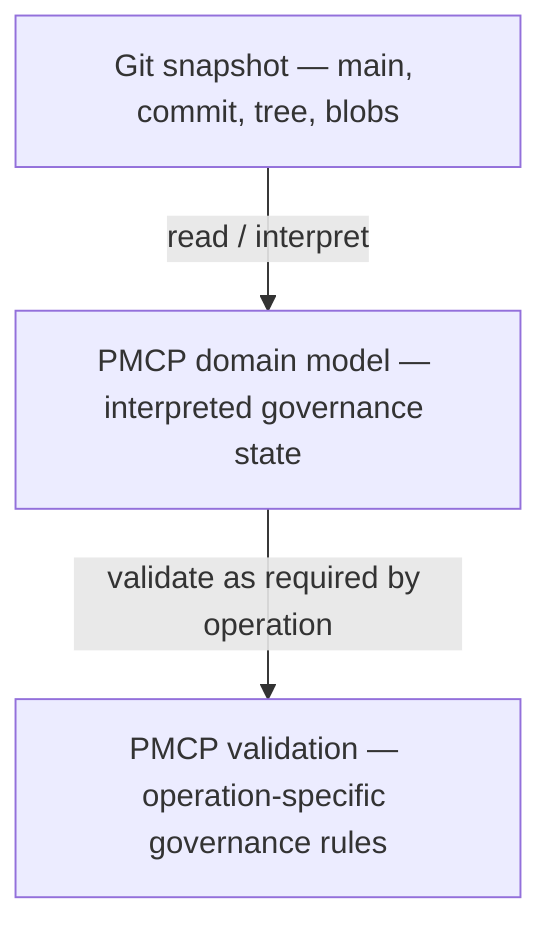

# PMCP Current-State & Design Assessment

**Last updated:** 2026-11-26  
**Repository:** `gunesis-game/pmcp`  
**Working branch:** `main` only  
**Assessment mode:** Ongoing, evidence-based assessment; static inspection unless execution is explicitly recorded.

## Review scope — assess the delta against the project baseline

**Mandatory reading:** Anyone using this review MUST first read `requirements.md` and `architecture.md` in full. Those documents define the product and its intended architecture; this review deliberately does not repeat their content. The current code must also be examined as the implementation under review.

This document records the evidence-based assessment and the **proposed delta** against those inputs: what should change in requirements, architecture, or implementation; why; what has been agreed; and what remains unresolved. It distinguishes current facts, proposed changes, approved decisions, and implementation work. A review proposal does not become a product requirement or architecture decision unless explicitly approved and recorded in the relevant baseline document.

## North Star — Review tracking and continuity

**The review document is the durable source of truth for this review. Chat history is not the tracking mechanism.**

- Every agreed decision, rejected proposal, unresolved question, review status, and resume point must be recorded in `review.md` on `main` as the review progresses.
- After the user agrees to a decision, update and commit `review.md` **before moving to the next topic**.
- Keep the checkpoint current enough that a lost session can be resumed without reconstructing context from chat.
- If the tracker cannot be updated or the commit cannot be verified, stop review progression and explicitly report the failure. Do not continue accumulating unrecorded decisions.
- Do not make implementation changes without explicit user approval.

## Purpose

This document is the persistent cross-session record of the assessment and proposed changes to PMCP. It evaluates the current `requirements.md`, `architecture.md`, and code, then records the proposed and agreed delta from that baseline.

The reader is required to consult `requirements.md` and `architecture.md` for the product definition and intended design. This review records evidence, critical assessment, proposed changes, decisions, unresolved questions, and the resulting change scope.

**The existing requirements, architecture, and implementation are all reviewable; none is presumed correct merely because it exists.** The purpose is to establish what should be retained, changed, or removed, and to make the rationale and agreed delta recoverable across sessions.

The assessment should establish and continually update:

- What the current requirements state, and whether they are sound, complete, coherent, and appropriate.
- What the current architecture proposes, and whether its assumptions, structure, boundaries, and trade-offs are sound.
- What the current code actually does, independent of whether it matches the requirements or architecture.
- Where the three agree, disagree, are incomplete, or make unsupported assumptions.
- What appears valuable to retain, what should be changed, what should be removed, and what remains unknown.
- The evidence and reasoning behind assessments so future sessions can continue without reconstructing lost history.

## Working principles

- Treat **requirements, architecture, and code as three reviewable inputs**, not as a hierarchy in which one automatically validates the others.
- Evaluate correctness and suitability, not just conformance.
- Do not automatically classify divergence from current requirements or architecture as a code defect.
- Do not assume matching implementation proves requirements or architecture are good.
- Distinguish observed facts, assessment/inference, open questions, and decisions.
- Preserve behavior and dependencies as facts even when recommending discarding or redesigning them.
- No implementation changes without explicit approval.
- Work directly on `main`; no branches or pull requests.
- Static review is not runtime proof. Only record tests or experiments as executed when they actually ran.
- Update this document in place after every assessment session. Keep the matrix/register as the current synthesis; keep session history concise and focused on what changed, decisions made, and where to resume. Do not duplicate matrix content in session notes.

## Handoff / current next step

The assessment is not yet demonstrated exhaustive. Previous work covered the areas in the matrix below and accumulated candidate validator/test observations, but has not established a complete file-by-file and symbol-by-symbol accounting of all current code, nor a complete critical assessment of the requirements and architecture themselves.

**Next:** continue the assessment in a neutral manner. Establish traceability between current requirements, architecture, and all code; critically assess each of the three; capture missing coverage and questions; then use the evidence to support redesign decisions. Do not presume the old architecture needs to be extended.

## Current assessment matrix

| Area | Assessment coverage | Current understanding / assessment |
|---|---|---|
| Requirements and documentation | README, requirements status, documentation authority and decision authority | Initial documentation/status issue was corrected. Requirements remain Draft. Their correctness, completeness, coherence, and fitness for purpose are not yet comprehensively assessed. |
| Architecture and design assumptions | Architecture status, conceptual structure, intended boundaries and feature exposure, architecture-to-tree comparison | Architecture remains Under review. Its fundamental assumptions and design quality are open questions; it is not a baseline to preserve automatically. |
| Coordinator/request lifecycle & replay | Request validation, allowlisted dispatch, read-only/lock behavior, retries, replay, result envelope, next-request derivation | Previously inspected. No confirmed defect was established; R-004 is a robustness question. Functional suitability and design assumptions remain open to reconsideration. |
| CI/evidence selection, polling & gates | Workflow selection/validation, polling, evidence capture, tier/gate semantics, cancellation/failure, policy timing | Previously inspected. R-001 is a policy-snapshot semantics question; R-002 tier overwrite aligns with the per-SHA model; R-003 is observed completion behavior. These are design observations, not endorsements. |
| State/snapshot encoding & integrity | Typed state, clone/re-encode, canonical encoding, digest scope, integrity acceptance | Previously inspected. Digest covers sorted `.pmcp/*.json` state files; project docs/policy excluded by design. Whether this integrity boundary is the right one remains open. |
| Decision ledger & approvals | Propose/record/list, approval modes, decision fields, policy approval refs, cross-record refs | Previously inspected. R-005 is a persisted-state consistency question; cross-record handoff links are not explicitly required by the current Draft contract. Both contract and model may change. |
| Plan updates & reconciliation | Task/criterion mutations, matching, evidence, no-op, reviewed sources, item/reference normalization, persisted metadata | Previously inspected. R-006–R-009 and R-013 are observations/questions about invariants and consistency. Criterion reset/removal is not specified. Whether these concepts and workflows are desirable remains open. |
| Cycle lifecycle, order, preemption & completion | Start/pause/block/unblock/cancel/reorder, micro-cycle promotion, default order, phase gates, timestamps, micro metadata | Previously inspected. R-010 and R-011 are validator questions. The lifecycle model and phase/gating concepts themselves remain open to design reassessment. |
| Checkpoint, handoff, journal & audit | Handoff/checkpoint fields, event log, journal, audit window/watermark, audit advancement | Previously inspected. R-012 is a persisted-state semantic question. Existing audit checks and lifecycle coupling have not been established as optimal design. |
| Repository-store/publication boundary | Store interface/fake, expected-head checks, concurrency retry, commit/read-back/ancestry, atomic publication and failure paths | MemoryStore paths were inspected. Production adapter behavior is unverified. Current abstraction, publication strategy, and guarantees remain open for design review. |
| MCP product/bootstrap & delivery scope | Architecture-to-tree comparison, tool/resource/prompt exposure, configuration, transport, GitHub MCP passthrough/adapters | Source tree reviewed appears to lack runnable server/bootstrap and production GitHub integration components described by architecture. This is a possible delivery gap, but scope and architectural assumptions are themselves unsettled. |
| Tests, evidence & runtime behavior | Test inventory and gaps across validators, plan/reconcile, evidence, replay, store, bootstrap | Source inspection only; no tests executed during this review. Test inventory did not show dedicated validator and plan/reconciliation test files. Runtime behavior remains unverified. |
| Cross-cutting quality & suitability | Not yet systematically assessed across all requirements, architecture, and code | Major open assessment area: complexity, unnecessary concepts, cohesion, usability, failure modes, maintainability, and whether PMCP is solving the right problem. |

## Assessment observations / questions register

These are retained from prior review work as observations to investigate—not a defect backlog and not a commitment to preserve the current requirements or design. They can be reclassified, rewritten, closed, or discarded as the assessment develops.

| ID | Area | Observation / question | Current disposition |
|---|---|---|---|
| R-008 | Reconciliation validation | Recorded metadata appears to allow partial states; should reconciliation metadata have atomic pristine-or-complete semantics? | Needs invariant/design decision |
| R-005 | Decision validation | What consistency is required among approval, recorded-at, specification, and verified-revision metadata for recorded decisions? | Current validator omission observed; model/invariant open |
| R-007 | Reconciliation items | Should persisted item and evidence text be trim-aware nonblank, consistent with action-path validation? | Consistency question |
| R-006 | Reviewed sources | Is a nonempty reviewed-source list required, or can empty review be meaningful? | Workflow/requirement question |
| R-010 | Cycle validation | What timestamps are required for each lifecycle state, including never-started/cancelled cases? | Lifecycle semantics open |
| R-012 | Checkpoint/handoff | What integrity relationships should exist among handoff fields, journal entries, and timestamps/events? | State model question |
| R-011 | Micro-cycle validation | Should eligibility reason and acceptance criteria be trim-aware nonblank, and should micro-cycle concepts exist in the model? | Requirements/design question |
| R-013 | Plan criterion validation | What semantics should govern criterion done-state and evidence, including evidence on unmet criteria? | Requirement semantics open |
| R-009 | Reconciliation references | Scalar whitespace references appear handled differently from whitespace list elements. Should normalization be consistent? | Consistency question |
| R-001 | Evidence governance | Should evidence selection use a policy snapshot during CI wait or revalidate if policy changes? | Design question |
| R-004 | Request idempotency | What should happen when a request ID is reused with a different payload? | Robustness/contract question |
| R-002 | Evidence storage | Same cycle/SHA evidence is replaced when tier changes. Is one-record-per-SHA the right data model? | Design trade-off, not endorsed |
| R-003 | Completion gate | Completion requires full-tier passing evidence. Is that gate appropriate for the intended workflow? | Existing behavior; design question |

## Prior investigation map (not a defect/test priority list)

| Investigation | Previously noted coverage / questions |
|---|---|
| Requirements and architecture validation | Critically assess completeness, contradictions, assumptions, fitness for purpose, and whether the system is solving the right problem—not only code conformance. |
| Persisted state model | Reconciliation states, decision metadata, cycle timestamps, handoff/journal relationships, micro-cycle text fields, criterion evidence semantics, valid minimal states. |
| Mutation/workflow behavior | Plan/reconcile operations, reviewed-source semantics, reference normalization, ambiguous matching, no-op behavior, task/criterion updates, and whether these workflows are needed at all. |
| Evidence and gates | Policy changes during CI wait; same SHA across tiers; pass/fail/pending gate combinations; completion-gate suitability. |
| Request replay | Same ID/same payload and same ID/different payload semantics; replay side effects. |
| Publication/storage | Head movement, retry, ref update failure, read-back failure, uncertain retry, multi-file atomicity, delete vs empty content, ancestry/no-force guarantees, and suitability of the store abstraction. |
| Product delivery | Server/tool/resource/prompt shape, configuration, transport, GitHub MCP passthrough, adapters, and what product scope is actually intended. |
| Runtime evidence | Run tests or targeted experiments only when approved/available; record commands, outcomes, and limitations. |

## Previously recorded implementation observations

These are factual observations from earlier static inspection, subject to re-verification as the repository changes. They are not endorsements of the design.

- Evidence preparation occurs before the branch lock to avoid holding the lock during CI polling.
- Evidence is collected against a commit SHA and stores tier, required workflows, checks, SHA and gate.
- `required_workflows` overrides policy workflow selection; default tier is full; default wait is policy-configured or 15 minutes.
- Evidence polling evaluates latest run per workflow and attaches failure details.
- Snapshot parsing/encoding is typed; clone encodes and reparses; state digest covers sorted `.pmcp/*.json` files only.
- Cycle completion requires a recorded full-tier passing evidence result.
- MemoryStore checks expected-head equality under its mutex and copies written bytes; it is test infrastructure, not production-adapter verification.
- Decision approval modes include attested and issue-comment validation; issue-comment checks approver membership, excludes the acting account, requires post-proposal timing and decision-specific approval text.
- Registry-to-record references and evidence SHA/tier are validated; strategy gates require approved Recorded decisions.
- Audit advancement records watermark, audit row, handoff boundary and journal entry together; validator checks watermark non-negative and anchored to completed execution order.

## Delivery/scope question

Earlier source-tree review suggested governance rules, coordinator abstractions and test fakes exist, while runnable MCP server/bootstrap, GitHub MCP passthrough, MCP transport/adapters, and production GitHub store/facts adapters described by architecture were not found. This observation needs re-verification against the current tree and against a deliberately reconsidered product scope. It must not be treated as proof that those components are necessarily required.

## Direct-to-main change tracking

- All repository work happens directly on `main`. No branches or pull requests.
- No implementation changes without explicit approval.
- Record approved changes here by commit and brief purpose; do not use PR tracking.

## Session continuity log

This log exists specifically to recover continuity when agentic sessions end. Keep entries concise, recording the session's net progress, decisions, newly assessed scope, unresolved questions, and exact next step. Do not restate the matrix/register/backlog; update those sections directly and use session entries as pointers to the changed sections.

### Session 31 — Consolidated review baseline (reframed)

- Previous sessions reviewed broad implementation areas and accumulated R-001–R-013 observations; their chronological detail was removed in the earlier roll-up.
- This review was reframed from defect-finding against presumed-correct requirements/architecture to a neutral assessment of requirements, architecture, and implementation—all of which may be wrong or redesigned.
- Exhaustive traceability across every current code file/symbol and critical assessment of requirements and architecture has **not** been established.
- No tests executed; no source changes made as part of the assessment.
- **Resume at:** neutral, evidence-based traceability and critical assessment. Identify areas requiring deeper inspection; do not assume the goal is to evolve/preserve current architecture.

## Overall assessment status

**Ongoing current-state and design assessment.** No confirmed defect established to date. No tests executed. No implementation fixes made. Requirements, architecture, and code are all open to reconsideration. The current matrix is a partial assessment map—not an exhaustive inventory or a statement that the current system is correct.

## Architectural decisions established during the current review

These decisions were agreed conversationally and must be treated as the current review baseline, subject to further explicit revision:

| ID | Decision | Implication |
|---|---|---|
| A-001 | Git is authoritative for repository state | Git commit/tree/blob/history are the source of truth; PMCP must not duplicate Git snapshot/persistence capabilities unnecessarily. |
| A-002 | Separate three concepts: Git snapshot, PMCP domain interpretation, and PMCP validation | Git snapshot is the input; PMCP interprets governance files into its domain model; validation checks governance integrity/rules. |
| A-003 | Always operate on `main` | Branches are not an application-level PMCP concept. No branch selection or branch-aware architecture. |
| A-004 | No PMCP concurrency subsystem | Do not implement PMCP locks, concurrency management, retry orchestration, or branch-movement recovery. Git owns commit identity/history. |
| A-005 | Validation is operation-specific | Validation requirements depend on the operation's purpose, inputs, dependencies, and effects. Do not impose a blanket full-state validation pipeline. |
| A-006 | Domain model should not duplicate repository mechanics | PMCP domain state should contain interpreted governance concepts, not raw repository file management, Git snapshot mechanics, changed-path detection, publishing, or commit identity. Generic serialization is not inherently a domain responsibility. |

### Agreed conceptual layering

### Further questions (not yet decided)

- Whether malformed/partial state should block a specific operation remains operation-dependent. Parsing failures are distinct from semantic governance validation (A-007).
- Whether a lightweight application/request service is needed after removing branch/lock/retry/snapshot machinery, or whether the existing coordinator should be substantially reduced/replaced.

## Session 32 — Architecture simplification decisions and tracking correction

- User emphasized that "tracking" means **actually updating `review.md` in the repository**, not merely maintaining a chat recap. This failure was acknowledged.
- Updated this file on `main` with the agreed decisions A-001 through A-006, the agreed conceptual layering, unresolved questions, and this session log. This commit is the durable checkpoint; future approved decisions must be recorded in this file before review continues. If the repository update cannot be completed, stop and explicitly report the failure instead of proceeding with more decisions.
- Review focus moved toward governance/domain responsibilities. Initial source inspection surfaced `internal/state/snapshot.go` as combining parsed domain records with raw files, parse errors, serialization/clone, changed-file detection, and digest mechanics. The user agreed that the domain model should not own raw repository-file management or Git snapshot mechanics.
- No code changes were authorized. This session only updates the review tracker.
- **Resume at:** critically inspect governance/domain operations in current source, one issue at a time, and persist each approved decision to `review.md` on `main` before moving forward. Decision A-007 now settles the separation of parsing, domain interpretation, and operation-specific semantic validation.

## Review update — Product North Star added to baseline documents

- At the user's direction, added the shared **Product North Star — Reliable work across limited agent sessions** to the opening of both `architecture.md` and `requirements.md`.
- The framing states that PMCP must support agents with limited reasoning capability, small context windows, short/interrupted sessions, and lost conversation history.
- It establishes the governed GitHub repository as the single durable project memory, containing both the project implementation and its PMCP governance/project knowledge. It explicitly rules out a separate PMCP-managed project database or independently maintained governance store.
- It explains PMCP's role as interpreting and validating repository-resident knowledge and exposing explicit MCP operations/guidance so agents can recover context and continue after session loss or agent replacement.
- This product framing belongs in the requirements and architecture baseline documents. `review.md` remains the delta assessment record and logs this change rather than redefining the product purpose.
- Verified both documents on `main` after writing: `architecture.md` content SHA `e42c51d9d23b5b98db92492ab40c1779176f90d8`; `requirements.md` content SHA `b9a017bbe6610246f8501e0625249fc91cb51bd4`.

### A-007 | Parsing, domain interpretation, and semantic validation

**Status: Approved by the user on 2026-11-26.**

- Parsing converts repository file contents into typed values and returns explicit parsing errors; malformed or missing input is a parsing concern.
- Domain interpretation represents PMCP governance concepts and their relationships. It does not own raw Git/repository file management.
- Semantic validation evaluates governance rules over interpreted domain values. It is distinct from parsing.
- Each governance operation determines which inputs must parse and which semantic rules must hold for that operation. A global full-state validation pipeline is not to be introduced as a replacement.
- Remove `ParseErrors` and `IsUsable()` as domain-model responsibilities; do not simply relocate the same global usability gate.
- Raw repository files, serialization, cloning, digests, and changed-path detection remain outside the PMCP domain model.

Rationale: syntactically malformed data and semantically invalid governance state are different failure classes. Their relevance depends on the operation being performed. Keeping repository representation and mechanics out of the domain model preserves the agreed boundary in A-001/A-002/A-006.

### Session 33 — Parsing and validation separation

- User approved A-007. Recorded the decision above and updated the unresolved parsing question and resume point.
- No implementation changes authorized or made.
- **Resume at:** inspect the current governance operations and their actual input dependencies/validation behavior. Use concrete call sites to assess whether the operation-specific boundary is respected; propose one next design decision at a time and record approval here before continuing.

### A-008 | Canonical governance state file and Git-backed history

**Status: Approved by the user on 2026-11-26.**

- Replace the multiple `.pmcp/*.json` governance state files with one canonical `.pmcp/state.json` file.
- The canonical file represents the complete current PMCP governance state at a given Git commit.
- Git commits and history are the sole source of version history. PMCP must not introduce a separate state-versioning or history store.
- Governance operations may retrieve the state file from `HEAD` and relevant ancestor commits, then compare snapshots to understand state transitions.
- The amount of history inspected is determined by the needs of the operation; do not impose a universal fixed history depth.
- Distinguish structural state comparison from governance interpretation: a diff identifies what changed, while PMCP governance rules determine the meaning and validity of that transition.
- A repository commit does not necessarily represent a governance transition; commits that do not change `.pmcp/state.json` need not be interpreted as state transitions.

Rationale: Git already provides immutable commit snapshots and historical retrieval. A single canonical state file simplifies the persistence and parsing boundary while preserving Git as the only durable source of state history. It does not eliminate semantic validation of relationships and governance rules within or across snapshots.

No implementation changes are authorized by this decision.

### Session 34 — Canonical state representation decision

- User approved A-008: one canonical `.pmcp/state.json`, with Git commits as the sole state history and operation-dependent historical comparison.
- Recorded A-008 in this review tracker on `main`; no implementation files changed.
- **Resume at:** continue inspecting actual governance operation call sites and their input dependencies/validation behavior. Then assess operation-specific validation as a separate decision. The previously discussed validation proposal is not yet approved.
### A-009 | Operation-specific dependencies and validation

**Status: Approved by the user on 2026-11-26.**

- Each governance operation must have an explicit set of state inputs it reads.
- Each operation must identify the invariants that must hold for those inputs.
- Each mutation must identify the state it changes and the invariants that must hold after the mutation.
- Historical comparisons are required only when the operation's governance rules depend on the transition; they are not an automatic prerequisite for every operation.
- Semantically invalid unrelated governance data must not block an operation whose required inputs and invariants are valid.
- Comprehensive repository/governance validation remains available as a diagnostic capability, but is not a prerequisite gate for every operation.
- Do not introduce a global `IsUsable()` gate or an equivalent all-state usability gate.
- Use an operation-dependency matrix as the design specification before changing the coordinator.

Clarification: the canonical `.pmcp/state.json` must still parse as a complete document before it can be interpreted. Operation-specific validation narrows semantic preconditions and invariants; it does not imply partial parsing of malformed JSON.

Rationale: operations have different state dependencies and governance obligations. A global validation gate allows unrelated semantic defects to prevent valid work. Explicit dependencies make preconditions, mutation effects, and any required historical comparisons reviewable and testable.

No implementation changes are authorized by this decision.

### Session 35 — Operation-specific validation decision

- User approved A-009: explicit per-operation state dependencies, preconditions, mutation effects, and post-mutation invariants; no global usability gate.
- Record that full-state validation remains diagnostic rather than a universal operation gate.
- No implementation files changed.
- **Resume at:** construct and verify the operation-dependency matrix from all registered operations, including exact state fields, repository inputs, historical reads, and mutation effects. Reconcile the matrix with requirements and architecture docs before proposing implementation changes.
### A-010 | Normative operation contract

**Status: Approved by the user on 2026-11-26.**

- Every registered governance action must have an explicit operation contract.
- Each contract specifies required parsed state inputs; state records/fields read; semantic preconditions and invariants; conditional dependencies and their activation conditions; external inputs (repository documents, Git history, GitHub data); exact state records/fields it may mutate; and post-mutation invariants.
- Dependencies must be minimal and explicit. Unrelated governance records must not be required to be semantically valid.
- Conditional behavior must be represented explicitly; do not make every possible dependency mandatory for every invocation.
- External inputs remain distinct from canonical governance state. Git/GitHub and repository mechanics are not responsibilities of the governance domain model.
- All mutation effects must be declared, including journals, checkpoint metadata, timestamps, revisions, and other secondary effects.
- Historical comparisons are specified only where a governance rule requires historical context. No automatic history scan or universal history depth.
- The coordinator must enforce each operation's contract: ensure required inputs are available and parsed, invoke operation-specific preconditions, and verify declared postconditions. It must not reinstate a global full-state validation or usability gate.
- The operation-dependency matrix is to be formalized and verified as the design specification before coordinator redesign or implementation.

Rationale: a normative contract makes operation dependencies, governance obligations, external facts, mutation effects, and historical requirements explicit and testable. It replaces implicit global assumptions with reviewable per-operation behavior.

No implementation changes are authorized by this decision.

### Session 36 — Normative operation contract decision

- User approved A-010 as written.
- The first-pass operation-dependency matrix is accepted as the basis for detailed contracts, subject to refinement against actual registered actions and call paths.
- No implementation files changed.
- **Resume at:** formalize and verify the detailed operation contracts for every registered action, including conditional branches, exact fields, external inputs, mutation side effects, preconditions, postconditions, and historical requirements. Then reconcile `requirements.md` and `architecture.md` with A-007 through A-010 before proposing coordinator redesign.
### A-011 | Detailed cycle operation contracts

**Status: Approved by the user on 2026-11-26.**

- The ten cycle action contracts reviewed in Session 37 are approved as the detailed basis for coordinator redesign: `cycle.create`, `cycle.start`/`cycle.resume`, `cycle.pause`, `cycle.block`, `cycle.unblock`, `cycle.cancel`, `cycle.transition`, `cycle.complete`, `cycle.promote`, and `cycle.reorder`.
- Contracts capture required state, conditional dependencies, mutation effects (including journal/checkpoint metadata), no-op behavior where identified, and historical comparison requirements.
- Preserve conditional lifecycle behavior: micro cycles lack ordinary plan/checkpoint records until promoted; preemption may pause and promote an existing micro cycle; completion may resume another paused cycle.
- The identified `pauseCycle` checkpoint assumption must be corrected during implementation: required checkpoint dependencies must be explicit, and missing required checkpoints must not result in silent partial updates. The current behavior is not approved as a valid invariant.
- The completion operation's audit-status calculation is part of its current output behavior; it is not thereby authorized to mutate independent audit state.
- These contracts specify intended behavior and dependencies, not authorization to preserve every current implementation detail.

No implementation changes are authorized by this decision.

### Session 37 — Cycle operation contract approval

- User approved all ten detailed cycle operation contracts.
- No implementation files changed.
- **Resume at:** formalize the remaining non-cycle operation contracts (plans, checkpoints, decisions, evidence, audit, and status), then verify all contracts against registered actions and implementation call paths. Reconcile requirements and architecture with A-007 through A-011 before proposing implementation.